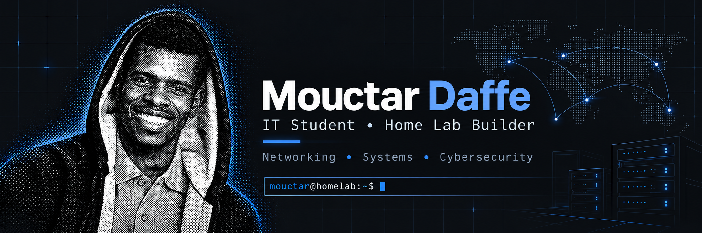

## About me

I'm a computer science student at UQAC in Saguenay, Quebec (cybersecurity concentration). I'm finishing the Google IT Support Professional Certificate and preparing for the Cisco CCNA.

I learn best with my hands on real equipment, so I built a home lab with Cisco switches, a mini PC and a Dell laptop. This GitHub is where I document what I build, what breaks, and how I fix it.

I'm looking for an IT support, help desk or junior network/infrastructure role or internship.
[LinkedIn](https://linkedin.com/in/mouctar-daffe) · French (fluent) · English (improving)

## Home lab

| Device | Role |
|---|---|
| Cisco Catalyst 3750-X | Layer 3 switch, inter-VLAN routing |
| Cisco Catalyst 2960-X | Layer 2 access switch |
| TP-Link TL-SG1016DE | Managed switch |
| Beelink SER9 Pro (Ryzen 7, 32 GB) | Virtualization host (Proxmox VE) |
| Dell laptop | Physical Ubuntu Server |
| MacBook Pro M4 | Admin workstation |
| GNS3 | Simulation for CCNA labs |

Addressing follows an enterprise-style plan: `10.10.0.0/16` per site, with the third octet matching the VLAN ID (10 servers, 20 HR, 30 IT, 40 security lab, 50 users, 60 VoIP, 70 Wi-Fi, 80 guest, 90 DMZ, 99 management).

A real problem I had to solve: my Ubuntu server had no Internet access (no Wi-Fi card, no cable to the router yet). I kept it updated by routing `apt` through a reverse SSH SOCKS tunnel from another machine.

## Lab progress

| Lab | Status |
|---|---|
| Enterprise VLAN addressing plan | Done |
| Ubuntu Server: static IP, SSH administration, updates through a reverse SSH tunnel | Done |
| GNS3 troubleshooting labs (addressing, VLANs, connectivity) | Ongoing |
| Proxmox VE on the Beelink | In progress |
| Active Directory: users, groups, GPO, domain join | Next |
| pfSense firewall to isolate the lab | Planned |
| FortiGate VM | Planned |

## Repositories

- [MDAFFE17-Lab](https://github.com/Mdaffe17/MDAFFE17-Lab): one folder per lab with the goal, topology, configs, tests and problems solved.
- [Learning-Journey](https://github.com/Mdaffe17/Learning-Journey): notes and exercises in networking (CCNA), Linux and Python.

## Skills

**Networking:** TCP/IP, IPv4 subnetting, VLANs, inter-VLAN routing, DNS, DHCP, NAT, Cisco IOS
**Systems:** Windows 10/11, Linux (Ubuntu Server), SSH, users and permissions, Proxmox VE
**Security:** least privilege, network segmentation, firewall principles
**Programming:** Python, C++ (basics), Git

## Certifications

- Google IT Support Professional Certificate (finishing)
- Cisco CCNA 200-301 (preparing)
